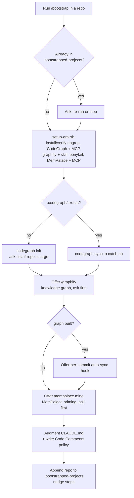

# bootstrap

One command that takes a repo — and a teammate's fresh machine — from nothing to ready for this Claude Code setup. No more "which extensions do I need, and how do I wire them up?" A teammate clones a repo, runs `/bootstrap`, and the toolchain gets installed, configured, indexed, and the repo gets recorded as done. After that, a session-start hook nudges anyone who opens a repo that hasn't been bootstrapped yet, so nobody works in a half-configured project by accident.

## How it works

`/bootstrap` runs a fixed sequence per repo. The setup step installs only what's missing (idempotent — safe to re-run), and the slow steps ask before they run.



Walkthrough: `setup-env.sh` checks each tool with `command -v` and installs the gaps — `brew install ripgrep`, `codegraph` via volta/npm then `codegraph install -y` to wire its MCP, `graphifyy` via uv/pipx then `graphify install` for the skill, the ponytail plugin written into `~/.claude/settings.json`, and `mempalace` via uv/pipx with its MCP registered. Then `/bootstrap` builds the CodeGraph index (asking first on a large repo), optionally builds the graphify graph, and — only if a graph got built — offers a per-commit hook that refreshes it on every `git commit`. It augments the repo's `CLAUDE.md` and, by default, writes the standard `## Code Comments` policy (no comments by default; one-line `why` only) verbatim into `CLAUDE.md` plus any existing `AGENTS.md` / `AGENT.md` (root and nested), then appends the repo path to `~/.claude/.bootstrapped-projects` so the session-start nudge stops firing for it.

Plugins and the CodeGraph MCP only surface after a Claude Code restart — `/bootstrap` says so at the end.

## What you get

| Piece | Role |
|------|------|
| `skills/bootstrap/SKILL.md` | the `/bootstrap` flow Claude runs per repo |
| `skills/bootstrap/setup-env.sh` | idempotent installer for the toolchain — also runnable standalone from a terminal |
| `skills/bootstrap/install-graphify-sync.sh` | wires the per-commit graphify auto-sync hook into a repo's `.claude/` |
| `skills/bootstrap/code-comments.md` | the canonical `## Code Comments` policy block written verbatim into `CLAUDE.md` / `AGENTS.md` / `AGENT.md` |
| `skills/bootstrap/templates/` | the `graphify-sync.sh` / `graphify-sync.py` files that hook copies into a repo |
| `hooks/bootstrap-check.sh` | SessionStart nudge — fires in any project not yet in `.bootstrapped-projects` |
| `install.sh` | symlinks the skill + nudge hook, wires the SessionStart hooks into `settings.json` |

The toolchain it installs:

| Tool | What it is | How it's installed |
|------|-----------|--------------------|
| **ripgrep** | the `rg` binary, fast search | `brew install ripgrep` |
| **CodeGraph** | `@colbymchenry/codegraph` CLI + its MCP server, then a built index of the repo | volta/npm install → `codegraph install -y` → `codegraph init` |
| **graphify** | the `graphifyy` PyPI package (provides the `graphify` CLI, Python 3.10+) + the `/graphify` skill | `uv tool install graphifyy` (or pipx) → `graphify install` |
| **ponytail** | the [ponytail](https://github.com/DietrichGebert/ponytail) plugin — lazy-senior-dev mode (YAGNI, stdlib-first, fewest lines) | marketplace + enable written to `~/.claude/settings.json` |
| **MemPalace** | the [MemPalace](https://github.com/MemPalace/mempalace) memory engine — cross-session memory, verbatim storage, **local embeddings (no API key, no LLM call, no quota)** | `uv tool install mempalace` + `claude mcp add mempalace -- mempalace-mcp` |

## Install — send this README to Claude Code

> **🤖 Claude Code — if a user sent you this README, install it now. Steps:**
>
> 1. **Preflight.** Confirm `git`, `jq`, and the `claude` CLI are on PATH.
> 2. **Clone (idempotent):**
>    ```bash
>    git clone https://github.com/unisol1020/ai-tools.git ~/.ai-tools 2>/dev/null \
>      || git -C ~/.ai-tools pull --ff-only
>    ```
> 3. **Run the installer** (symlinks the `/bootstrap` skill + the nudge hook, wires the SessionStart hooks into `settings.json` — backs it up first):
>    ```bash
>    bash ~/.ai-tools/bootstrap/install.sh
>    ```
>    Add `--with-deps` to also install the toolchain (ripgrep / CodeGraph / graphify / ponytail / MemPalace) right now. **Ask the user first** — it runs brew / npm / uv.
> 4. **Verify:** `ls -la ~/.claude/skills/bootstrap` is a symlink into `~/.ai-tools/bootstrap`.
> 5. **Report back:** tell the user to **restart Claude Code once**, then open any repo and run **`/bootstrap`** — it installs the required extensions if missing, builds the CodeGraph index, offers `/graphify`, and records the repo. The ponytail plugin and the CodeGraph + MemPalace MCPs surface after the restart.
>
> Update later with `git -C ~/.ai-tools pull` — the symlink picks it up.

### Requirements

macOS or Linux, [Claude Code](https://claude.com/claude-code), `git`, and `jq`. For the toolchain: `node`/`npm` (or volta) for CodeGraph, `python3` for graphify, and Homebrew for ripgrep. The installer fills the gaps it can.

### Manual install

```bash
git clone https://github.com/unisol1020/ai-tools.git ~/.ai-tools
~/.ai-tools/bootstrap/install.sh          # add --with-deps to also install the toolchain now
```

Then restart Claude Code.

## Use it

The teammate path, start to finish:

1. Install this once (above), restart Claude Code.
2. Open any repo. Claude nudges you that it isn't bootstrapped.
3. Run **`/bootstrap`**. It installs what's missing, indexes the repo, asks before the slow steps (large-repo indexing, `/graphify`, `mempalace mine`), and records the repo as done.

Want to set the toolchain up from a terminal without opening a repo? Run the bundled script directly — it installs only what's missing:

```bash
bash ~/.claude/skills/bootstrap/setup-env.sh
```

### Per-commit graphify auto-sync

If `/bootstrap` built a graphify graph, it offers a `PostToolUse` hook (written to the repo's `.claude/settings.local.json`). After every `git commit`, the hook runs a silent AST pass that refreshes `graphify-out/graph.json` from the commit's changed code files — zero tokens, the model is never involved. The files land in the repo's `.claude/`, which is personal and gitignored, so it's never imposed on teammates via shared git hooks. Code stays fresh automatically; **doc/README/spec changes still need a manual `/graphify --update`**.

## Privacy

`~/.claude/.bootstrapped-projects` lists the real repo paths you've set up. It lives under `~/.claude` and is never committed to this (or any) repo — only the generic tooling ships here.

## Uninstall

```bash
rm ~/.claude/skills/bootstrap ~/.claude/hooks/bootstrap-check.sh
# then remove the SessionStart entries for bootstrap-check.sh and the codegraph sync from ~/.claude/settings.json
```

The MemPalace hooks (SessionStart, UserPromptSubmit, Stop, SessionEnd, PreCompact) also run scripts
inside the skill dir. Once it is removed they fail on every turn, so delete them in the same step:

```bash
jq '.hooks |= with_entries(.value |= map(.hooks |= map(select(.command | contains("mempalace") | not)))
                            | map(select(.hooks | length > 0)))' ~/.claude/settings.json > /tmp/s.json \
  && mv /tmp/s.json ~/.claude/settings.json
```

## Memory: MemPalace (and migrating off claude-mem)

`setup-env.sh` installs [MemPalace](https://github.com/MemPalace/mempalace) (MIT, 3.11+), registers
its MCP at user scope, and `mempalace-wire-hooks.sh` wires five hooks into `~/.claude/settings.json`.
Every one goes through `mempalace-hook.sh`, which runs `mempalace_hooks.py` under MemPalace's own
Python:

| Hook | Effect |
|---|---|
| `SessionStart` | injects `wake-up` (~800 tokens) for the repo you are in |
| `UserPromptSubmit` | searches the repo's wing with your prompt and injects up to 3 memories that clear a similarity bar |
| `Stop` | saves after each turn |
| `SessionEnd` | saves on close |
| `PreCompact` | saves before context compaction |

**One wing per repo, not per directory.** Saving and recall have to agree on the wing, or recall
reads a wing nothing is saved into. MemPalace names a session's wing after the leaf of its cwd, so
a T3 worktree (`~/.t3/worktrees/mono/t3-1a2b`) or an Orca workspace
(`~/orca/workspaces/mono/bug-login`) became its own wing, and before 3.11 every transcript landed
in one flat `sessions` wing. `mempalace_hooks.py` resolves the cwd to the repo's main checkout
(`git rev-parse --git-common-dir`, falling back to the worktree's parent dir once it is deleted) and
files and reads under that repo's name, so `mono` is one wing however many worktrees touched it.
T3 scratch and temp dirs map to the machine's workstation wing.

**Recall on every prompt** is what makes the palace get used. The wake-up is a fixed summary and
the model rarely calls `mempalace_search` on its own, so `recall` searches with the prompt itself
(~1-2 s) and injects hits only above `MEMPALACE_RECALL_MIN_SIM` (default 0.5, calibrated for the default `minilm` embedder). Below that it adds
nothing, so an unrelated prompt costs no tokens. Prompts under 20 characters and slash commands are
skipped.

`mempalace-rules.sh` writes a short block into `~/.claude/CLAUDE.md` telling the model to search
the palace before answering about past work, quote results verbatim, and say so when the palace
has nothing rather than guessing.

MemPalace stores verbatim text and embeds locally. No API key, no per-session model call, nothing
to exhaust, which is why it replaced claude-mem here: its observer needs an LLM call per session
and fails closed when that allowance runs out.

### Re-filing a palace built before this

Palaces built earlier hold a flat `sessions` wing, per-worktree wings and month-sized claude-mem
chunks that start mid-sentence. Stop every `mempalace-mcp` process (they hold the palace lock),
back up, then:

```bash
cp -cR ~/.mempalace/palace ~/.mempalace/palace.bak       # APFS clone; plain cp -R elsewhere
bash ~/.claude/skills/bootstrap/mempalace-hook.sh reorg --reimport-claude-mem
```

`reorg` splits every wing holding transcripts by repo, using `mempalace wings split` with the
targets rewritten to repo names. `--reimport-claude-mem` re-exports one file per memory, then drops
the drawers mined from the earlier export and mines each project into its repo wing. It needs
`~/.claude-mem/claude-mem.db` plus `node` and `sqlite3`, so run it before any
`--purge-claude-mem`. Without the database, run plain `reorg`. It waits out the palace lock that
live sessions' Stop hooks take, and re-running it is safe. Expect about an hour per 30k memories.

### Migrating an existing claude-mem database

```bash
bash ~/.claude/skills/bootstrap/mempalace-migrate.sh            # export + mine + hooks
bash ~/.claude/skills/bootstrap/mempalace-migrate.sh --remove-claude-mem   # ...and retire the old plugin
```

| Flag | Effect |
|---|---|
| *(none)* | export → mine → wire hooks. claude-mem left running. |
| `--remove-claude-mem` | disable the plugin + stop its worker. **Database kept.** |
| `--purge-claude-mem` | also `rm -rf ~/.claude-mem`. Irreversible — only after you trust recall. |
| `--skip-mine` | export + hooks only. |
| `--fresh` | rebuild the palace per-project. **Needed if an earlier run mined everything into one flat `claude_mem_export` wing** — the script detects that and refuses to stack on top of it. |
| `--with-cloud` | also install the third-party cloud plugin (see below). |

Everything claude-mem stored is covered: `observations` and `session_summaries` become one
markdown file each, mined into the project's wing, `user_prompts` are mined as their own `prompts` wing, and
`tool_uses` + `sdk_sessions` are dumped to JSON in the archive. Those last two live nowhere else —
without them, deleting `~/.claude-mem` loses them for good.

The export is a read-only SQLite→markdown transform — **no LLM calls, no cost**. One file per
memory means every drawer starts at that memory's title, and no file comes near MemPalace's
per-file chunk cap, which skips oversized files **silently**.

Your original transcripts in `~/.claude/projects/` are the higher-fidelity source — claude-mem's
observations are LLM summaries *of* them. To file those verbatim instead:

```bash
mempalace mine ~/.claude/projects/<project-dir> --mode convos
```

### A note on MemPalace Cloud

`cschnatz/mempalace-cloud-plugin` is a **third-party** plugin (not the MemPalace org) that adds
OAuth, multi-device sync and a web UI. It is **not installed by default**, and for good reason:
its hooks auto-save to `https://api.mempalace.cloud/mcp`, **not** your local palace. Running it
alongside the local setup splits memory across two backends, and uploads session content —
including anything work-related — to a third party. Opt in with `--with-cloud` only deliberately.

The open-source core has no web UI. Inspect the palace locally instead:

```bash
mempalace status
mempalace search "what you're looking for"
sqlite3 ~/.mempalace/palace/chroma.sqlite3 \
  "SELECT substr(string_value,1,300) FROM embedding_metadata WHERE key='chroma:document' LIMIT 20"
```
